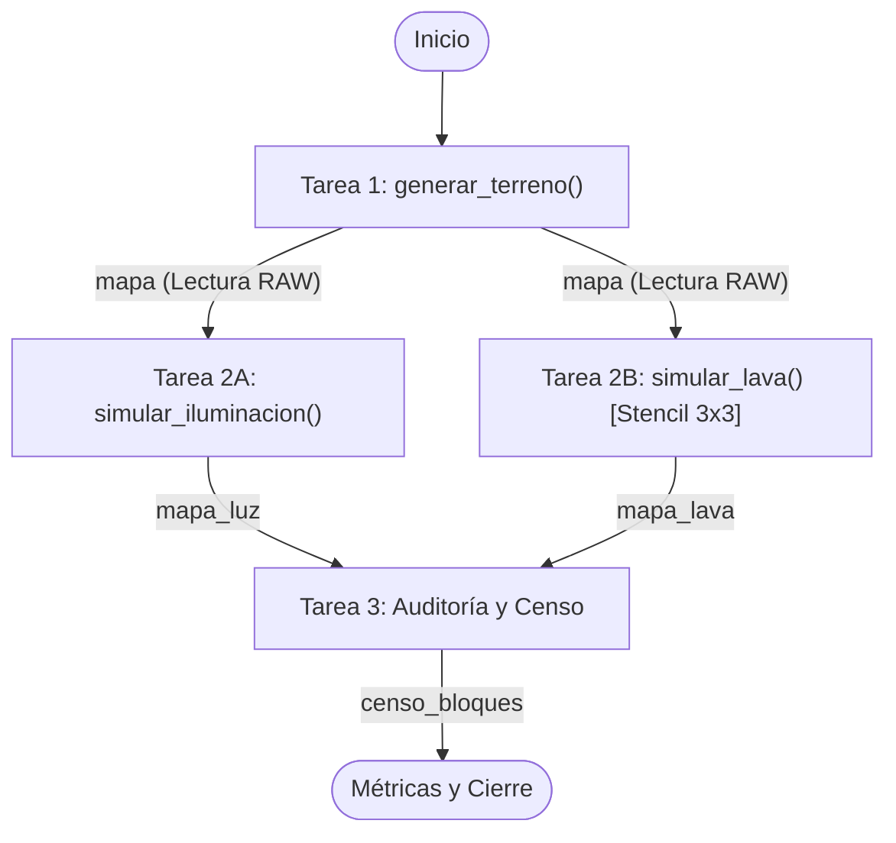
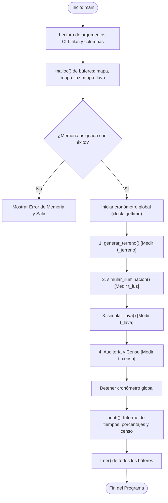

# Documentación Arquitectónica - Práctica 2 (Versión Base)

## 1. Grafo de Dependencias de Tareas (Apartado 2.1)

Representación formal de dependencias de precedencia (Read-After-Write) y paralelismo funcional (*Fork-Join* de 2 ramas independientes):

### Justificación Teórica:
- **Paralelismo de Datos:** Las tareas internas procesan las matrices fila a fila sin dependencias entre celdas dentro del mismo paso.
- **Paralelismo Funcional:** Las tareas 2A y 2B leen de forma no destructiva la matriz `mapa` (solo lectura con `const int*`) y escriben en matrices disjuntas (`mapa_luz` y `mapa_lava`), permitiendo su ejecución concurrente sin regiones críticas ni bloqueos.
- **Barrera de Sincronización (Join):** La Tarea 3 actúa como punto de encuentro para procesar el censo de bloques y los puntos iluminados antes de liberar la memoria.

---

## 2. Diagrama de Flujo de Ejecución Secuencial (`main.c`)

Secuencia temporal del proceso en la CPU:

