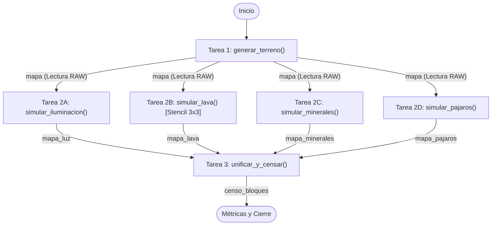
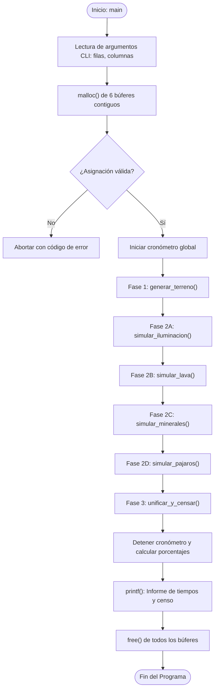

# Documentación Arquitectónica - Práctica 2

## 1. Grafo de Dependencias de Tareas (Apartado 2.1)

Representación formal de dependencias de precedencia (Read-After-Write) y paralelismo funcional (*Fork-Join* de 4 ramas):

### Justificación Teórica:
- **Paralelismo de Datos:** Cada tarea interna divide su matriz por filas sin dependencias cruzadas entre celdas.
- **Paralelismo Funcional:** Las tareas 2A, 2B, 2C y 2D operan simultáneamente sobre la entrada común `mapa` (solo lectura) y generan buffers independientes en memoria sin requerir bloqueos de exclusión mutua.
- **Sincronización (Join):** La Tarea 3 actúa como barrera de sincronización y resuelve colisiones físicas (Magma + Mineral = Obsidiana).

---

## 2. Diagrama de Flujo de Ejecución Secuencial

Secuencia temporal del proceso en la CPU:

